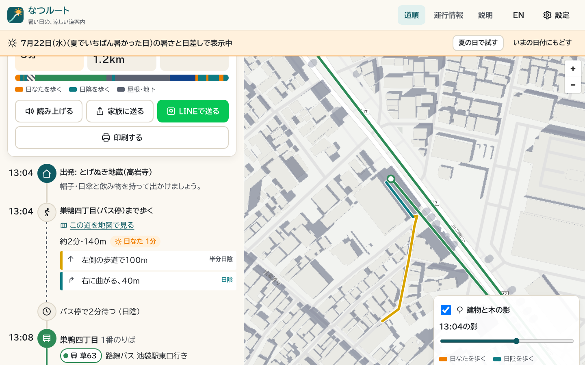
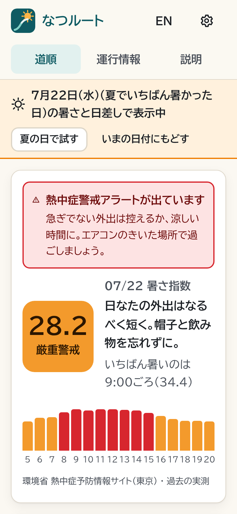
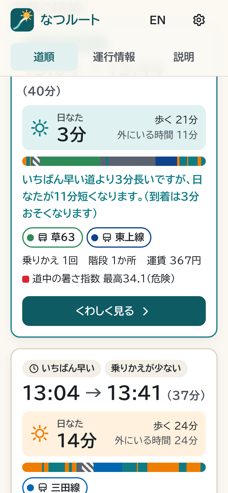
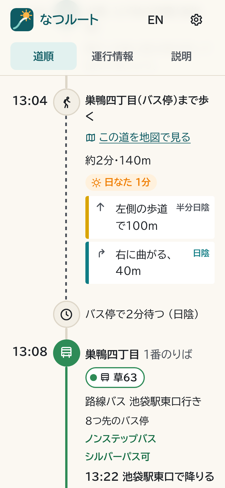
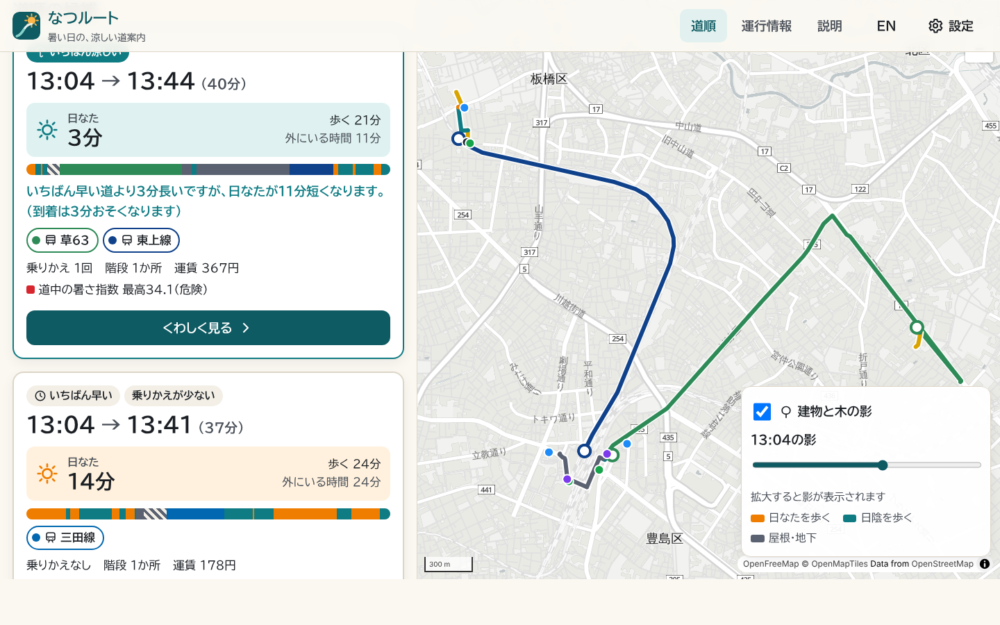
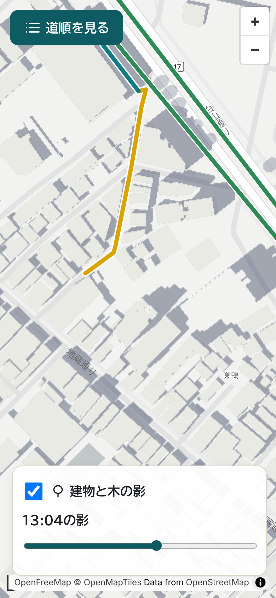

**English** · [日本語](README.ja.md)

# NatsuRoute（なつルート）

Door-to-door train and bus routes that keep you out of the sun on hot days, for Tokyo's 23 wards. Built for older people and the families who look out for them. An entry to the Public Transportation Open Data Challenge 2026.



Journey planners choose routes by speed. On a hot afternoon, though, the same trip can mean fourteen minutes in direct sun or three, depending on which side of the street you walk, which station entrance you use, and whether you wait at a bus stop with shade. NatsuRoute works out where the shade falls at the minute you will be there, from the 3D city model of every building and tree, and picks routes with that in mind.

<p>



</p>

## What it does

- **Minutes in the sun first.** Every option leads with the time you will spend in direct sun, shows the whole trip as one bar (sun, shade, roofed, waiting, riding), and says what the cooler way costs: *"3 minutes longer than the fastest way, with 11 minutes less in the sun."*
- **Which pavement to use.** Pavements run beside the road, not down its middle, so each side is shaded separately and the steps say which one to use: *"100 m, on the left pavement (part shade)"*.
- **When to leave home,** so you are not standing at a sunny bus stop. Waits are counted too: the platform (roofed) or the kerb, in sun or shade, with or without a roof and a bench.
- **Station entrances by exit number,** with whether each is step-free. People who cannot use stairs are never sent through an entrance known to have only stairs. Slopes and kerbs come from MLIT's walking-space survey data.
- **Places to rest on the way:** Tokyo's designated cooling shelters (with opening hours), convenience stores, drinking water, toilets and benches.
- **The heat index** (WBGT, from the Ministry of the Environment) now and hour by hour, heatstroke alerts, and **"Another time?"**, which runs the same trip at seven times of day so you can pick a cooler time to go.
- **Trains and buses together.** Timetables for 15 rail operators (JR East, Tokyo Metro, Toei, Tokyu, Odakyu, Keio, Seibu, Tobu, Keikyu, Sotetsu, Tsukuba Express, Rinkai Line, Yurikamome, Yokohama subway, Tama Monorail) and for Toei, Tokyu, Seibu and Kokusai Kogyo buses, with step-free (non-step) buses marked. Fares can be shown for holders of the **Tokyo Silver Pass**, the yearly pass for Tokyo residents aged 70 and over that covers Toei lines and buses in Tokyo.
- **A shade map.** The shade of every building, elevated road and tree, drawn for any minute you choose, with the route coloured by sun and shade.
- **Made to be easy to use:** a universal-design typeface (BIZ UDPGothic), large text by default (one size smaller and one larger), high-contrast mode, 56 px touch targets, steps read aloud by the phone's own voice, a "send to family" button (share sheet or LINE), print, Japanese and English, light and dark, installable.
- **All year:** in winter it can pick sunny streets instead, and on rainy days roofed ones. Between November and April, when the ministry publishes no heat index, **"Try a summer day"** replays a real day from last summer (its heat index and its sun's path) on today's timetables.

## What it changes

Measured by [`pipeline/tools/study.ts`](pipeline/tools/study.ts) with seeded random trips across the 23 wards, for the heat and sun of 22 July 2026, the hottest day of the summer. Full tables are in [docs/study.md](docs/study.md).

- **Door to door at 13:00** (114 trips, 1.5–7 km): the median time in direct sun falls from **11.1 minutes** on the fastest route to **5.8 minutes** on the coolest. When a cooler option exists (85 of 114 trips), it takes a median **5.8 minutes** longer.
- **Walks of 400–1,200 m:** the heat-aware path cuts time in the sun by a median 20–26%, for about a minute of extra walking.
- **Bus stops:** between 10:00 and 14:00, **58–68%** of the 6,565 bus stops in the 23 wards stand in full sun. That is a ready list for ward offices deciding where shelters would help most.

These figures describe the model, not measured exposure (see *Accuracy and limits*).

One trip, as the app shows it: from Togenuki Jizo in Sugamo to the Tokyo Metropolitan Institute for Geriatrics and Gerontology, leaving at 13:04 on the replayed 22 July. The fastest way has 14 minutes in the sun; the coolest has 3, by taking the 草63 bus from a shaded stop, and arrives 3 minutes later.



## How it works

```
PLATEAU 3D city model ─┐ buildings, trees, elevated decks, bus-stop roofs
OpenStreetMap ─────────┼─► shade casters ───► shade engine: a ray from chest height
                       │                       towards the sun, for any minute
OpenStreetMap ─────────┤ walking network
Hokonavi (MLIT) ───────┴─► roofs, underground passages, stairs, lifts, slopes, kerbs

ODPT timetables ──────────► trains + buses ───► RAPTOR
Ministry of the Environment ► heat index, alerts ─► how much a detour into shade is worth
Tokyo cooling shelters ───► rest stops
```

1. **Shade.** About 3 million buildings, tree crowns, elevated roads and bus-stop roofs from PLATEAU (and trees from OpenStreetMap where PLATEAU has none) become outlines with a height band. To ask "is this spot in the sun at 13:04?", the engine casts a ray from chest height (1.2 m) towards the sun, through a 24 m grid of casters, and checks every outline the ray crosses against its height band. Decks shade what is under them but not what a low sun reaches beneath them; tree crowns let some light through. A ray takes about 8 µs.
2. **Pavements.** For roads, shade is sampled on both pavements, set back from the centre line by half the carriageway (pulled back if that lands inside a building), so the router knows which side is shady.
3. **Walking.** A Dijkstra search on 1.14 million path segments weighs seconds in the sun against extra walking. The weight follows the heat index at that hour (from 0.3 s of detour per second of sun at "almost safe" up to 4 s at "danger") and the person's choice (coolest / balanced / fastest). The sun moves as the walk goes on.
4. **Door to door.** Walks outward from the start and backward from the destination reach every station entrance and bus stop within the walking limit. They become RAPTOR sources and targets; stops reached through more sun count as reached later, so the search leans towards shadier ones. This runs with no weight, the heat's weight and a stronger one. Each candidate is then rebuilt as a real trip: the earliest service once the walk is known, each walk shaded at the minute it is walked, the waits, fares and rest stops. The options that nothing else beats on arrival, sun, changes and walking are kept and labelled.
5. **Shade map.** Map tiles are drawn on the server from the same casters. Each shadow is the area an outline sweeps away from the sun between the bottom and top of its height band; rooftops are cleared, so the map shows shade where people walk.



## Data

| Source | Used for |
|---|---|
| ODPT (公共交通オープンデータセンター), incl. Challenge 2026 data | train and bus timetables, stations, bus stops, fares, live status and delays |
| Project PLATEAU, MLIT (CC BY 4.0) | buildings, trees, elevated roads and rail, footbridges, bus-stop roofs, arcades |
| Hokonavi DP walking-space network data, MLIT | roofs, underground passages, building corridors, stairs, lifts, slopes and kerbs in 13 station areas |
| OpenStreetMap (ODbL) | walking network, street names, station entrances, trees, toilets, water, benches, shelters |
| Ministry of the Environment heat illness prevention site | heat index (forecasts and hourly estimates), heatstroke alerts, past summer days |
| Tokyo Metropolitan Government heatstroke portal | 2,003 cooling shelters and cool-share spots in the 23 wards |
| GSI address search and reverse geocoder | shelter locations; naming the current location |
| National Land Numerical Information N02, MLIT | track geometry and missing station positions |

Licences and credits are in [NOTICE.md](NOTICE.md). ODPT Challenge data is used under the Challenge's terms: it stays on the server, only plan results reach the browser, and nothing derived from it is committed.

## Running it

You need Node 20+, Python 3.11+, about 6 GB of free disk and 8 GB of memory for the build, and the ODPT keys from [developer.odpt.org](https://developer.odpt.org/) (the standard key and the Challenge 2026 token).

```sh
cp .env.example .env            # add ODPT_API_KEY, ODPT_CHALLENGE_TOKEN, CONTACT_EMAIL
npm ci
pip install -r geo/requirements.txt

# Geo layers, once (30-60 min): PLATEAU for 23 wards, the Kanto OSM extract,
# Hokonavi, cooling shelters.
mkdir -p data/raw/osm && curl -L -o data/raw/osm/kanto.osm.pbf \
  https://download.geofabrik.de/asia/japan/kanto-latest.osm.pbf
npm run geo

# Timetables (about 6 min) and the summer days to replay.
npm run data

npm run dev                     # API on :8787, app on http://localhost:5173
```

Useful tools:

- `npx tsx pipeline/tools/plan.ts 35.7369,139.7337 35.7508,139.7019 2026-10-14T13:00:00+09:00 2026-07-22` plans a trip in the terminal.
- `npx tsx pipeline/tools/study.ts` reruns the study.
- `npx tsx pipeline/tools/bench-shade.ts` times the shade engine.
- `npm test`, `npm run typecheck`.

## Deploying

The [Dockerfile](Dockerfile) builds everything inside the image, with the ODPT keys passed as build secrets:

```sh
docker build \
  --secret id=odpt_api_key,env=ODPT_API_KEY \
  --secret id=odpt_challenge_token,env=ODPT_CHALLENGE_TOKEN \
  -t natsuroute .
docker run -p 8787:8787 -e ODPT_API_KEY -e ODPT_CHALLENGE_TOKEN -e CONTACT_EMAIL=you@example.com natsuroute
```

The server needs about 1.2 GB of memory (the shade casters and walking network are kept in memory) and starts in about 6 seconds. A plan takes 0.5–1.5 s, and shade tiles take 10–40 ms each and are cached.

## Accuracy and limits

- Shade is estimated from building and tree data. Awnings, signs, parasols and clouds are not included; on cloudy days the sun is weaker than shown.
- Tree data is incomplete (PLATEAU has surveyed trees in a few central areas only), so tree-lined streets can look sunnier than they are.
- Shade is computed inside the 23 wards only. Walking outside them is shown as "shade unknown" and counted as sun when choosing.
- Time inside stations (entrance to platform) is an estimate. Station entrances come from OpenStreetMap: 885 stations have mapped entrances (2,831 in all); 347 are tagged step-free and 628 stairs-only, and the rest are unknown.
- JR East and Odakyu do not publish fares in open data, so those fares are listed as not included rather than guessed. Tokyu, Odakyu, Seibu and Keikyu trains are rebuilt from station timetables, so the odd trip can be slightly off. Keisei, Tokyo Monorail and a few smaller lines have no timetable in open data; their stations can be searched and walked to, but not ridden.
- The heat index is the ministry's estimate for the nearest of four observation points, and it includes sunshine. Shade lowers the radiant part of the heat, which is the point of the app, but the app does not claim a number for it.

## Project layout

```
geo/                 Python: PLATEAU, OpenStreetMap, Hokonavi, shelters → data/build/geo
pipeline/            TypeScript: ODPT trains and buses → network.json; heat replay; tools
src/server/shade/    sun position, shade engine, shade map tiles
src/server/walk/     walking graph, exposure model, heat-aware search, directions
src/server/          transit, access points, planner, heat, places, API
src/web/             the app (React, MapLibre)
tests/               unit tests (sun, shade, walking, RAPTOR, pipeline)
docs/                screenshots and the study
```

## Licence

NatsuRoute's code is MIT-licensed ([LICENSE](LICENSE)). The data belongs to its providers and is not covered by that licence; see [NOTICE.md](NOTICE.md).
